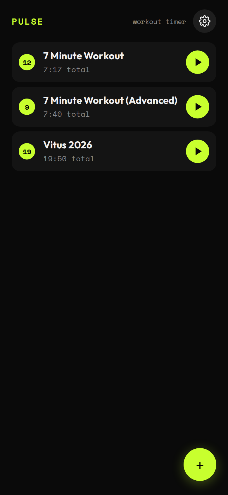
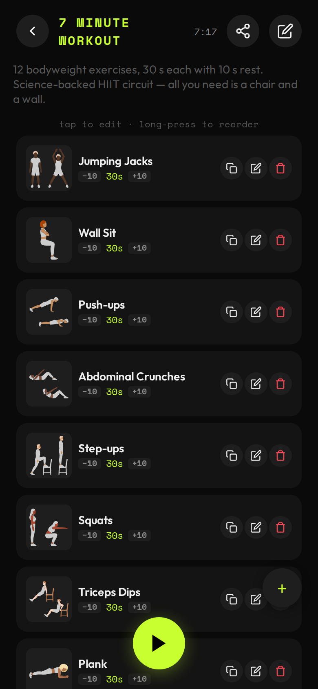
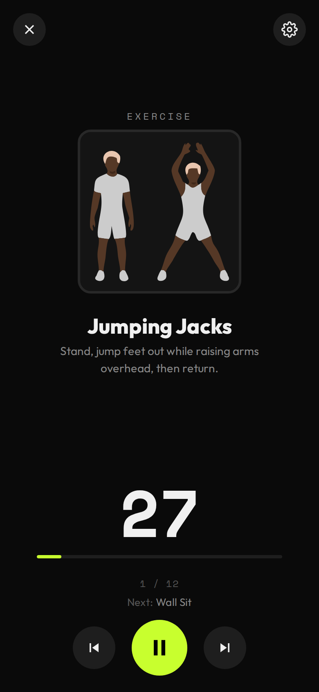
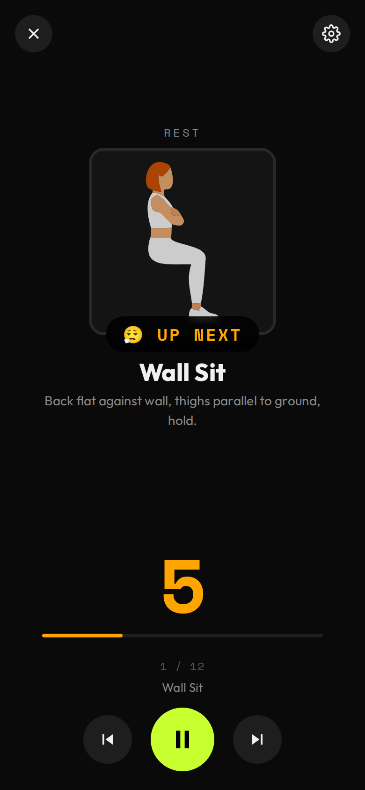

# PULSE

A small bodyweight workout timer that runs in the browser. No server, no account.
Inspired by [Feeel](https://gitlab.com/enjoyingfoss/feeel).

Demo: [vs.digital/pulse](https://vs.digital/pulse/)

<p>
  
  
  
  
</p>

You can create several trainings. Exercises come from [wger.de](https://wger.de) or can be added by hand, and you drag them to reorder. The player counts down each exercise and rest with beeps and voice cues, and shows what's coming next. Everything is stored in `localStorage` and can be exported or imported as JSON. You can install it as a PWA and use it offline, and it keeps the screen on during a workout.

## Running it

The whole app is one file, `index.html`. You can download it and open it directly. The illustrations for the built-in exercises are in `images/`, so put that folder next to the file if you want them.

The wger search, offline mode and the screen wake lock need HTTP(S):

```bash
python3 -m http.server   # or: npx serve .
```

## Development

- Tests (Playwright): `bun run test`. See [docs/TESTS.md](docs/TESTS.md).
- Versioning: a pre-commit hook bumps `APP_VERSION` in `index.html` and `CACHE_NAME` in `sw.js` on every commit that touches `index.html`. If you already bumped it yourself, the hook leaves it alone. To enable it after cloning, run `git config core.hooksPath hooks`.

To trigger the "built-in trainings updated" modal by hand, paste this into the browser console:

```js
const s=JSON.parse(localStorage.getItem('pulse_data'));
s.version='0.0.0';
delete s.settings._pendingBuiltinIds;
const v=s.trainings.find(t=>t.builtinId==='vitus-2026');
if(v) v.builtinHash='stale';
localStorage.setItem('pulse_data',JSON.stringify(s));
location.reload();
```

The modal needs both a stale `builtinHash` and a version that differs from `APP_VERSION`.

## Todo

- Export only trainings instead of the full state, so merging works better.
- Decide whether and how to update the default trainings.

## License

MIT. Code and exercise illustrations © Vitus Schuhwerk. Please keep the license notice if you reuse them.
